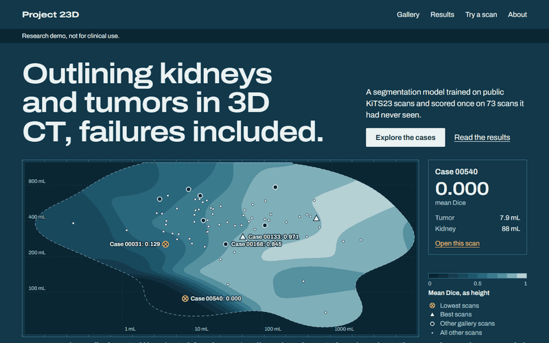

# Project_23D: Kidney Tumor Segmentation in 3D CT

A 3D segmentation model that finds kidneys, renal tumors and cysts in contrast-enhanced
CT scans. It is built with [nnU-Net v2](https://github.com/MIC-DKFZ/nnUNet) on the
[KiTS23](https://github.com/neheller/kits23) dataset, and evaluated once on a locked test
set with the official KiTS23 evaluator.

**Research and portfolio project. Not a medical device. Not for clinical use.**

```text
KiTS23 CT scans
  → checks every file against its checksum
  → splits by case, seed 42, with 73 test cases locked away
  → nnU-Net v2 trains one 3D U-Net on Kaggle's free GPU
  → scored once with the official KiTS23 evaluator, with 95% confidence intervals
  → case analysis: which tumors it finds, and where it fails
```

| Stage | State |
|---|---|
| Data: 489 cases staged, split 343/73/73, preprocessed on Kaggle | Done |
| Training: nnU-Net v2, `3d_fullres`, fold 0, 100 epochs | Done |
| Evaluation on the 73 test cases | Done |
| Public demo: website, live inference, database | Code done, not deployed yet ([phase 5 specs](specs/phase-05/README.md)) |

## Results

One fold, 100 epochs, internal test set of 73 cases, official KiTS23 evaluator. Each model was
scored once on these cases. This is not comparable to the KiTS23 challenge leaderboard.

| Region | Mean Dice (95% CI) | Median Dice |
|---|---|---|
| Kidney + masses | 0.903 (0.858–0.940) | 0.969 |
| Masses | 0.645 (0.572–0.715) | 0.799 |
| Tumor | 0.617 (0.543–0.691) | 0.773 |
| **Mean of the three** | **0.722 (0.665–0.777)** | 0.845 |

Mean surface Dice is 0.596 (0.550–0.641). Without post-processing, mean Dice is 0.652.
The model is strong on kidneys and on large tumors, and weak on small tumors and cysts. Full
results are in [reports/evaluation/results.md](reports/evaluation/results.md), and the current
state is in [docs/status.md](docs/status.md).

## Demo



The live site link will go here once it is deployed. To run the site locally, see
[apps/web/README.md](apps/web/README.md).

## Quick start

No GPU or dataset is needed to run the tests.

```bash
python -m venv .venv
.venv/Scripts/python -m pip install -r requirements-dev.txt
.venv/Scripts/python -m pytest -q
```

On macOS or Linux, use `.venv/bin/python` instead of `.venv/Scripts/python`.

To run the full pipeline, follow [docs/reproduce.md](docs/reproduce.md). Everything heavy
runs on Kaggle's free tier.

## Repository map

```text
src/project3d/      Library code: data, evaluation, inference, training
scripts/            Command-line entry points, one folder per stage
  notebooks/        Generators for the Kaggle notebooks
notebooks/          Generated Kaggle notebooks (do not edit by hand)
apps/web/           The demo website (Next.js)
apps/space/         The live model demo (Gradio on Hugging Face Spaces)
tests/              Pytest suite, mirrors src/ and scripts/
data/sources/       Pinned file lists and checksums (the data itself is not in git)
reports/            Run records and generated results
docs/               Documentation, start at docs/README.md
specs/              What each stage must deliver, one spec per stage
```

Each main folder has its own README. The most useful documents:

- [docs/README.md](docs/README.md): index of all documents
- [docs/project-overview.md](docs/project-overview.md): the problem and the scope
- [docs/architecture.md](docs/architecture.md): how the system fits together
- [docs/evaluation.md](docs/evaluation.md): how results are measured
- [docs/decisions.md](docs/decisions.md): every major decision and why
- [docs/deployment.md](docs/deployment.md): how the demo runs for $0

## License

The source code is MIT ([LICENSE](LICENSE)). The KiTS23 data, and the weights and sample
cases derived from it, are CC BY-NC-SA 4.0: non-commercial use only, shared under the same
terms. See [NOTICE.md](NOTICE.md).
